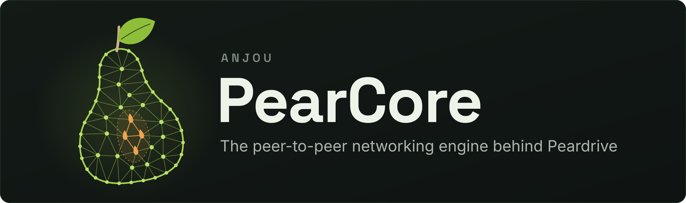

<p align="center">
  
</p>

<p align="center">
  <a href="https://github.com/peardrive/pearcore">
    
  </a>
  <a href="LICENSE">
    
  </a>
  <a href="https://github.com/peardrive/pearcore/pulls">
    
  </a>
  <a href="https://peardrive.github.io/pearcore/">
    
  </a>
</p>

<p align="center">
  <strong>PearCore</strong> is a modular peer-to-peer framework for building decentralized applications. It provides persistent accounts, private spaces, messaging, and a virtual file system.
</p>

<br>

## 📦 Installation

PearCore is published to npm and needs Node.js 22 or newer:

```bash
npm install pearcore
```

Every release is also available as a pinned tarball on the
[Releases](https://github.com/peardrive/pearcore/releases) page:

```bash
npm install https://github.com/peardrive/pearcore/releases/download/v0.2.2/pearcore-0.2.2.tgz
```

Replace `v0.2.2` in both places with the release you want. The newest release is
always available as
`https://github.com/peardrive/pearcore/releases/latest/download/pearcore.tgz`.

<br>

You can also install from the git tag, which builds the package on your machine:

```bash
npm install github:peardrive/pearcore#v0.2.2
```

If no prebuilt binaries exist for `better-sqlite3` or `sqlite3`, those builds
need a C/C++ toolchain.

<br>

## Quick Example

Here's a minimal setup to create an account, authenticate, and start using PearCore:

```javascript
import { createCore } from 'pearcore';

async function main() {
  // create fresh core instance
  const core = await createCore({
    rootPath: './data', // directory path to store account metadata
  });

  // create new account (publicKey + secretKey + internal database)
  await core.accounts.create('alice', 'securePassword123');

  // load the account
  await core.accounts.authenticate('alice', 'securePassword123');

  // create new space for peers to join
  const space = await core.space.create({ spaceName: 'ChatApp' });

  console.log('PearCore is running!');
  console.log(`use this sharelink to join space: ${space.sharelink}`);
}

main().catch((error) => {
  console.error(`Setting up PearCore has failed: ${error}`);
});
```

For more practical examples, see the **[Quick Start guide](./docs/examples.md)**.

<br>

## Networking

PearCore runs without central servers. Peer discovery and connections are handled by two libraries:

- **[HyperDHT](https://github.com/holepunchto/hyperdht)** — the distributed hash table that maps each space to a topic, so peers can find each other without knowing addresses in advance.
- **[Hyperswarm](https://github.com/holepunchto/hyperswarm)** — joins those topics and maintains direct, encrypted connections to the peers it finds. A peer can announce itself, look up others, or both.

Networking sits behind a small `PeerNetwork` abstraction in [`src/utils/network.utils.ts`](./src/utils/network.utils.ts), so the transport can be swapped without touching the higher-level services.

<br>

## Contributing

Branch model, commit conventions, local checks, and release-impact changesets
are documented in [CONTRIBUTING.md](./CONTRIBUTING.md).

<br>

## Documentation

The published documentation is available at **https://peardrive.github.io/pearcore/**. Its Markdown sources live in the [`docs/`](./docs) folder:

- **[Core Services Overview](./docs/core-services.md)** – all services and low‑level managers
- **[P2P Networking Overview](./docs/networking.md)** - all topics related to p2p networking of pearcore
- **[Account Management](./docs/accounts.md)** – creation, authentication, logout
- **[Spaces (Channels)](./docs/spaces.md)** – create, join, leave, and discover spaces
- **[Profile Management](./docs/profiles.md)** – update, broadcast, and list profiles
- **[Messaging](./docs/messages.md)** – send, receive, and filter messages
- **[File Sharing](./docs/files.md)** – upload, download, and monitor file transfers

<br>

### Working on the docs

The site is built with VitePress from the `docs/` directory:

```bash
npm run docs:dev
npm run docs:build
npm run docs:preview
```
